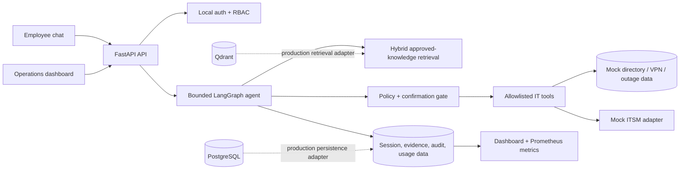

# Service Desk Deflection Agent

A locally runnable, production-shaped proof of concept that resolves common L1 IT requests from approved knowledge, executes only allowlisted actions with explicit confirmation, and creates diagnostic ITSM tickets when it cannot proceed safely.

The default model and ITSM providers are deterministic mocks. The complete demo therefore works without paid APIs or external credentials.

## Architecture



The checked-in demo profile uses SQLite and deterministic lexical-vector retrieval so it remains reproducible offline. Docker Compose also starts PostgreSQL and Qdrant to make the intended production boundaries explicit. See [docs/PRODUCTION_GAPS.md](docs/PRODUCTION_GAPS.md).

## Quick start: Docker

Prerequisite: Docker Desktop with Compose.

```bash
cp .env.example .env
docker compose up --build
```

Open the employee app at <http://localhost:3001>, API docs at <http://localhost:8001/docs>, health at <http://localhost:8001/health>, and metrics at <http://localhost:8001/metrics>.

Stop with `docker compose down`. Add `--volumes` only when you intentionally want to delete local demo data.

## Local development

Use Python 3.12 or newer and Node.js 20 or newer.

```bash
python -m venv .venv
# Windows: .venv\Scripts\activate
# macOS/Linux: source .venv/bin/activate
python -m pip install -e ".[dev]"
python -m apps.api.app.seed --reset
python -m uvicorn apps.api.app.main:app --reload --port 8000
```

In a second terminal:

```bash
cd apps/web
npm install
npm run dev
```

The Vite app is then available at <http://localhost:5173>.

## Demo users

These credentials exist only in local seed data:

| Role | Username | Password |
|---|---|---|
| Employee | `employee01` | `demo123` |
| Employee with locked account | `employee02` | `demo123` |
| Support agent | `support` | `support123` |
| Administrator | `admin` | `admin123` |

The seed contains 30 synthetic employees, two operations users, nine approved SOPs, mock account/VPN/outage states, 18 historical sessions, tickets, resolutions, and a reopen event.

## Main journeys

- `Reset my password` or `Unlock my account`: the agent retrieves an approved SOP, pauses, and changes state only after confirmation.
- `My VPN is not connecting`: the agent checks the user's mock VPN profile and verifies the result.
- `Is email down?`: the agent checks the authoritative outage adapter.
- `How do I report phishing?`: the agent answers from approved knowledge with a visible citation.
- `My quantum toaster is smoking`: no approved evidence exists, so the mock ITSM adapter creates a ticket containing the full diagnostic context.
- Prompt-injection or arbitrary-command requests are blocked and escalated without running the requested action.

## Commands

```bash
make setup          # install Python and web dependencies
make seed           # idempotent demo seed
make dev            # seed and run API
make test           # deterministic core pytest suite
make test-e2e       # three Playwright browser flows
make eval           # 120-case replay; JSON + Markdown reports
make lint           # Python + TypeScript checks
make web-build      # production web build
make compose-check  # validate Compose configuration
```

Equivalent commands work on Windows without `make`; see the recipes in `Makefile`.

## API examples

Log in:

```bash
curl -s http://localhost:8001/api/auth/login -H "Content-Type: application/json" -d '{"username":"employee01","password":"demo123"}'
```

Set the returned access token, then start a request:

```bash
curl -s http://localhost:8001/api/chat -H "Authorization: Bearer $TOKEN" -H "Content-Type: application/json" -d '{"message":"Reset my password"}'
curl -s http://localhost:8001/api/chat/SESSION_ID/confirm -H "Authorization: Bearer $TOKEN" -H "Content-Type: application/json" -d '{"approved":true}'
```

Operations users can request `GET /api/dashboard`, `GET /api/tickets`, and any session's safe trace. Employees can view only their own trace. More examples are in [docs/API.md](docs/API.md).

## Strict deflection semantics

A resolution is strictly deflected only when no human was involved, the tool/answer outcome was verified, and no reopen occurs inside `REOPEN_WINDOW_HOURS` (72 by default). Loose automation includes every automated resolution before that replay-window check. Historical seed data includes one reopen so both metrics are visible.

## Repository map

- `apps/web` — React + TypeScript employee and operations UI
- `apps/api` — FastAPI routes, auth, persistence, metrics, and seed
- `services/agent` — provider abstraction and explicit bounded LangGraph orchestration
- `services/retrieval` — document ingestion/chunking and hybrid retrieval
- `services/tools` — permission-aware action and ITSM adapters
- `packages/shared` — Pydantic contracts
- `infra` — migration and local infrastructure
- `tests` — unit, API, integration, Playwright, and evaluation suites
- `docs` — architecture, security, flow, API, evaluation, demo, and hardening guidance

No secrets are committed. Copy `.env.example` and supply deployment values through the environment.
