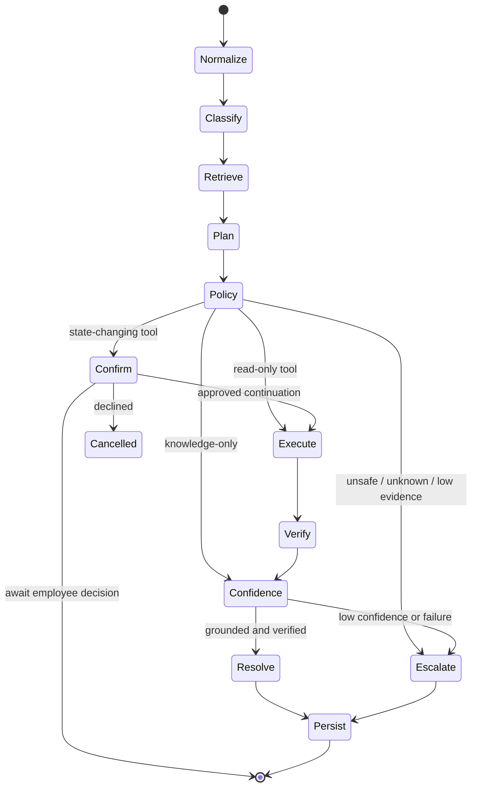

# Agent Flow

Every node emits a safe operational event with node name, decision summary, elapsed time, timestamp, and non-sensitive metadata. These events explain system behavior without exposing hidden reasoning.

Classification, retrieval, and tool verification contribute to confidence. The deterministic policy currently resolves at `>= 0.60`. Tool failure always escalates. A knowledge-only request also needs approved retrieval evidence. Maximum agent steps are configured through `MAX_AGENT_STEPS` and LangGraph's recursion limit.

The serialized confirmation checkpoint binds the pending tool and arguments to the session. An employee cannot confirm another employee's session or substitute a new tool/target in the confirmation request.

